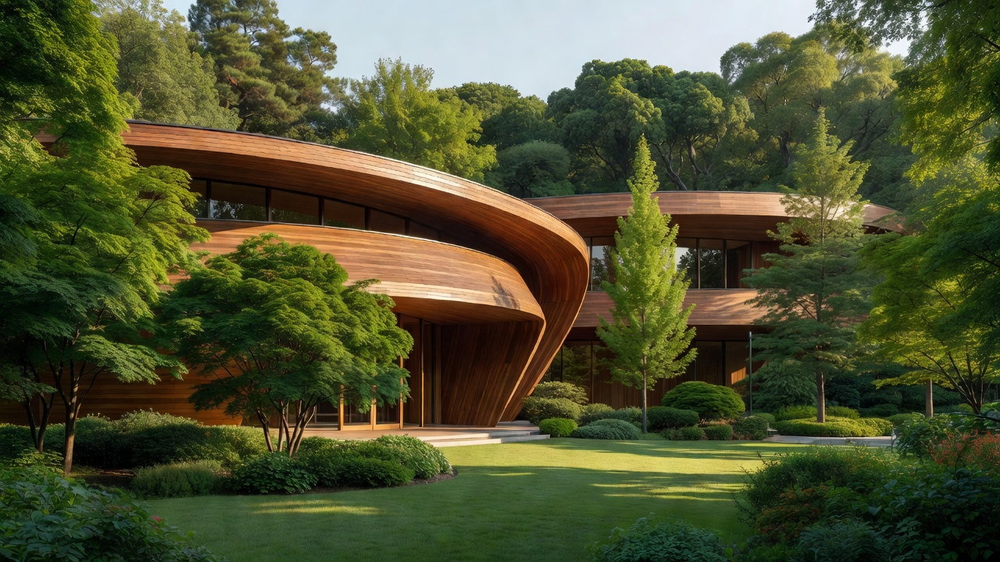

import ProblemBox from '../../../components/ProblemBox.astro';
import ConclusionBox from '../../../components/ConclusionBox.astro';
import BlogCard from '../../../components/BlogCard.astro';

<ProblemBox>
- 「MTG PARK」の最新発表会（11月24日）で明かされた新情報は？
- 正確な所在地や隈研吾氏の建築、ReFa CAFE・アートの見どころを知りたい
- 熱田神宮の参拝とあわせて行くべきか、向いている人の条件は？
</ProblemBox>

<b>名古屋市熱田区の複合施設「MTG PARK（エムティージー パーク）」が、2026年11月24日に建築の全容と完成イメージを初公開しました。</b>

同日には設計監修を手掛ける建築家・隈研吾氏ら6人のクリエイターが現地を視察し、2027年春のグランドオープンへ向けた準備が本格化。

株式会社MTGの公式発表によると、ReFa初のカフェや体験型ミュージアムに加え、ロッコ・リッチー氏の大型壁面アートも登場します。

熱田神宮参拝のあとに上質な美容体験やグルメを楽しみたい方なら、来春の開業スケジュールに必ず組み込むべき新名所。

## MTG PARKの場所はどこ？名古屋市熱田区三本松町25-1のアクセス

<b>正式な所在地は愛知県名古屋市熱田区三本松町25-1（101番2の一部を含む敷地）で、神宮東公園の西隣に建ちます。</b>

名鉄「神宮前駅」やJR「熱田駅」から徒歩圏内の立地。熱田神宮周辺のにぎわいを生む「熱田外苑プロジェクト」の中核拠点となります。

延床面積約14,905.75㎡・地上6階建てのスケールながら、周囲の公園や杜とつながる開放的な動線を備えます。

熱田神宮参拝のあとにゆっくり休める洗練されたカフェはこれまで限られていたため、駅近くでの新施設誕生は地元住民にも朗報。

では、11月24日の現場視察会で新たに明らかになった館内アートと店舗の全容はどうなっているのでしょうか。

<iframe src="https://maps.google.co.jp/maps?q=%E6%84%9B%E7%9F%A5%E7%9C%8C%E5%90%8D%E5%8F%A4%E5%B1%8B%E5%B8%82%E7%86%B1%E7%94%B0%E5%8C%BA%E4%B8%89%E6%9C%AC%E6%9D%BE%E7%94%BA25-1&output=embed" width="100%" style="border:0; aspect-ratio: 16 / 10; height: auto; border-radius: 8px; margin: 1rem 0;" allowfullscreen loading="lazy" referrerpolicy="no-referrer-when-downgrade"></iframe>

## MTG PARKの最新見どころは？隈研吾視察で判明した壁面アートと飲食

<b>「緑の丘」をテーマに曲線テラスを重ねた木質建築へ、美容体験・ブランド初カフェ・日本初の大型アート・本格レストランが集結します。</b>

2026年11月24日の発表会では、隈研吾氏ら6名の「つくり手」が現地に集結。日本の美意識を発信する拠点としての狙いが語られました。

| 施設・エリア名 | 11月24日公開の注目ポイント |
| :--- | :--- |
| **HIKARI LOBBY** | ロッコ・リッチー氏が日本で初めて手掛ける大型壁面アートを設置 |
| **MTG / ReFa MUSEUM** | ReFaやSIXPADの技術・製品を五感で体感できる世界唯一の空間 |
| **ReFa CAFE** | ReFaブランドとして世界初出店となるオリジナルカフェ業態 |
| **露結 -ROKETSU- / SANKA** | 中村外二工務店施工の懐石割烹（林大介料理長）とイノベーティブ・フレンチ |

単なる本社オフィスビルではなく、低層階を中心に一般来場者が気軽に入れる体験エリアとして設計されているのが強み。

買いたい美容アイテムをカフェやアート鑑賞のついでに試せるうえ、数寄屋建築の割烹まで同居する構成は全国でも異例です。

### MTG PARKの営業時間や専用駐車場の台数は決まった？

<b>各店舗の正式な営業時間および一般来場者向けの駐車場台数は、2026年11月25日時点では公表されていません。</b>

建物は2027年1月に竣工予定のため、営業時間の確定や予約受付開始は年明けから春前の開業直前案内になる見通し。

駅のすぐそばという立地特性上、オープン直後の混雑を避けるなら名鉄「神宮前駅」やJR「熱田駅」からの徒歩来訪が最も確実です。

### MTG PARKへ行くべき人と別の選択肢が合う人の違い

<b>ReFa製品の購入検討者や、建築・アート鑑賞と記念日ランチを1か所で楽しみたい方には間違いなく刺さる施設です。</b>

反対に、小さな子ども連れでファストフードをサッと済ませたい場合は、駅周辺の既存商業施設の方が気楽に立ち寄れます。

2027年1月の竣工後、春のオープン日が確定し次第すぐに現地へ足を運べるよう、まずは熱田神宮周辺の散歩ルートを想定しておくと安心。

## MTG PARKのよくある質問（FAQ）

### Q. MTG PARKのオープン時期はいつですか？

建物は2027年1月に竣工し、2027年春に複合施設「MTG PARK」としてグランドオープンする予定です。

### Q. MTG PARKのReFa CAFEやレストランは誰でも入れますか？

一般来場者向けに開放される複合施設のため、MTG社員以外でもReFa MUSEUMやカフェ、レストランを利用できます。

## MTG PARK名古屋熱田区の開業準備と確認ポイント

出典：[株式会社MTG 公式リリース](https://www.mtg.gr.jp/)

<ConclusionBox>
- <b>最新発表と場所：</b> 2026年11月24日に完成イメージ初公開。所在地は愛知県名古屋市熱田区三本松町25-1（神宮東公園西側）。
- <b>注目スポット：</b> 隈研吾氏監修の建築に、ロッコ・リッチー氏の日本初壁面アートや世界初のReFa CAFE、懐石「露結」が入居。
- <b>来訪の判断：</b> 駐車場台数は未公表のため、名鉄「神宮前駅」・JR「熱田駅」からの徒歩利用がスムーズ。
</ConclusionBox>

文化芸術や商業が融合する大規模複合施設の最新開発動向は、京都駅東南部の計画記事でも確認できます。

<BlogCard slug="2026-11-24-open-e54763" />
