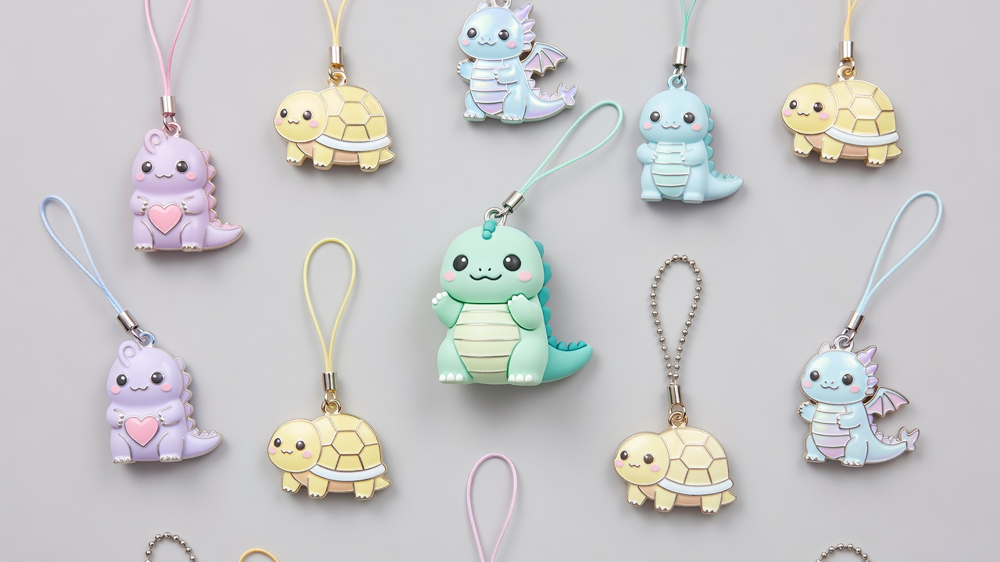

import ProblemBox from '../../../components/ProblemBox.astro';
import ConclusionBox from '../../../components/ConclusionBox.astro';
import BlogCard from '../../../components/BlogCard.astro';

<ProblemBox>
- 東宝のカプセルトイ「ゴジだま」の発売日・価格はいくら？
- 『ゴジラ-0.0』やサンリオコラボ第1弾の全ラインナップと種類数を知りたい
- どこで買えるのか、狙い目のシリーズはどれか判断したい
</ProblemBox>

<b>東宝株式会社のゴジラ部が展開する初のカプセルトイブランド「ゴジだま」第1弾が、2027年4月より全国で順次発売されます。</b>

東宝の公式発表によると、記念すべき第1弾は映画『ゴジラ-0.0』アイテムとサンリオコラボを含む全3シリーズを一挙に投入。

1回400円〜500円という手に取りやすい価格設定。重厚なメタルチャームからシリコンリング付きマスコットまで幅広い造形が揃います。

映画館グッズ並みのクオリティを街角のガチャで狙いたいゴジラファンやサンリオ好きなら、2027年春の発売月は確実チェック。

## 東宝ガチャ「ゴジだま」第1弾の価格と全3シリーズラインナップ

<b>第1弾は500円の2シリーズと400円の1シリーズで構成され、合計17種類のチャームが登場します。</b>

コレクション用途だけでなく、バッグや鍵にすぐ付けられる実用的なキーホルダー系が中心のラインナップ。

| 商品シリーズ名 | 価格（税込） | 種類数と主な仕様 |
| :--- | :--- | :--- |
| **ゴジラ-0.0 メタルチャーム** | 1回 500円 | 全5種 ／ 重厚感あるメタル仕様で映画の世界観を再現 |
| **GODZILLA・SANRIO CHARACTERS マスコットチャーム** | 1回 500円 | 全7種 ／ シリコンリング付きで持ち歩きやすいコラボ造形 |
| **ゴジラ ロッカーキー風チャーム** | 1回 400円 | 全5種 ／ カラフルでPOPなデフォルメ怪獣デザイン |

特に『GODZILLA・SANRIO CHARACTERS』は全7種と最多の種類数。推しのサンリオキャラを引き当てる競争率は高めになりそうです。

映画の余韻に浸りたい大人向けの重厚メタルと、普段使いしやすいPOPなデザイン。価格差100円で明確に棲み分けた巧みな構成です。

## 「ゴジだま」はどこで買える？販売場所と対象年齢の注意点

<b>全国のカプセル・トイ売り場にて2027年4月から順次展開予定で、対象年齢は3シリーズとも15歳以上です。</b>

具体的な設置店舗リストやオンライン事前予約の有無は、2026年11月25日時点では公表されていません。

東宝直営のゴジラ・ストアや大型シネコンのロビー、全国のショッピングモール内の大型カプセルトイ専門店が有力な入荷先になる見通し。

### 「ゴジだま」3種のうちどれを回すべき？選び方の基準

<b>作品ファンが質感重視で1つ選ぶなら「ゴジラ-0.0 メタルチャーム」、ギフトや推し活バッグに付けるなら「サンリオコラボ」が最適です。</b>

一方で、予算400円で複数回まわして怪獣仲間を並べたい方は「ロッカーキー風チャーム」が最もコスパよく楽しめます。

小さな部品を含むため、15歳未満の子ども向けプレゼントにする場合は誤飲などの点から親の管理のもとで扱うか見送る判断が無難。

## 東宝「ゴジだま」のよくある質問（FAQ）

### Q. 東宝カプセルトイ「ゴジだま」はいつから発売されますか？

第1弾の3シリーズともに、2027年4月より全国のカプセル・トイ売り場で順次発売される予定です。

### Q. 「ゴジだま」の価格と対象年齢はいくらですか？

『ゴジラ-0.0』メタルとサンリオコラボは1回500円（税込）、ロッカーキー風は400円（税込）。対象年齢は3シリーズとも15歳以上です。

## 東宝カプセルトイ「ゴジだま」第1弾の要点

出典：[東宝株式会社 公式リリース](https://prtimes.jp/)

<ConclusionBox>
- <b>発売時期と場所：</b> 2027年4月より全国のカプセル・トイ売り場で順次発売（対象年齢15歳以上）。
- <b>第1弾の価格・種類：</b> ゴジラ-0.0メタル（500円・5種）、サンリオコラボ（500円・7種）、ロッカーキー風（400円・5種）。
- <b>購入のポイント：</b> 店舗リストは続報待ち。映画ファンはメタル、推し活・普段使いならサンリオコラボの7種が狙い目。
</ConclusionBox>

サンリオキャラクターズとの最新コラボレーション商品の動向は、話題のコラボ記事でもあわせて確認できます。

<BlogCard slug="2026-11-23-trend-96cbd3" />
