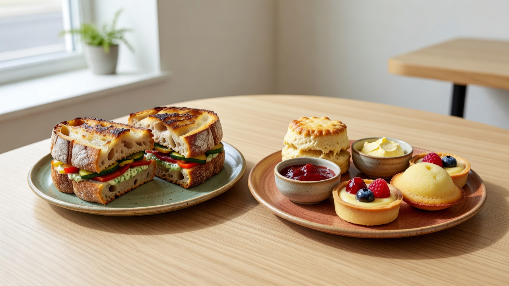

import ProblemBox from '../../../components/ProblemBox.astro';
import ConclusionBox from '../../../components/ConclusionBox.astro';
import BlogCard from '../../../components/BlogCard.astro';

<ProblemBox>
- ポール・スミス日本初カフェの場所と営業期間はいつまで？
- 福岡「パンストック」コラボメニューや雑貨の内容を知りたい
- 事前予約の可否や、表参道で立ち寄るべき人の条件は？
</ProblemBox>

<b>英国ブランド「ポール・スミス（Paul Smith）」が日本初となる期間限定ポップアップカフェ「Paul's Tea Shop A Pop up café by Paul Smith」を、2026年12月1日（火）に表参道へオープンします。</b>

場所は東京都渋谷区神宮前4-6-8の老舗カフェ「LOTUS（ロータス）」の2階で、営業時間は11:00〜21:00です。

約1年間の期間限定展開が予定されており、福岡の人気ベーカリー「パンストック」とのコラボフードが大きな目玉。

ファッション好きだけでなく、表参道で個性的なティータイムやギフト雑貨を一度に楽しみたい方なら見逃せない新スポット。

## ポール・スミス初カフェの場所はどこ？表参道LOTUS 2Fの地図

<b>所在地は東京都渋谷区神宮前4-6-8 LOTUS 2Fで、東京メトロ「表参道駅」から徒歩約5分の裏通りエリアです。</b>

クリエイティブディレクターは、同ビル1階の「LOTUS」や「BOWERY KITCHEN」を手掛けた山本宇一氏が担当します。

表参道のメインストリートから一本入った落ち着いたロケーションにあり、街歩きの途中にふらっと寄りやすい立地。

ブランドのアートウォールやウィンドウボックスで彩られた空間は、ただお茶を飲むだけでは終わらない没入感が魅力です。

では、店内で味わえるコラボメニューや限定グッズにはどのような特徴があるのでしょうか。

<iframe src="https://maps.google.co.jp/maps?q=%E6%9D%B1%E4%BA%AC%E9%83%BD%E6%B8%8B%E8%B0%B7%E5%8C%BA%E7%A5%9E%E5%AE%AE%E5%89%8D4-6-8&output=embed" width="100%" style="border:0; aspect-ratio: 16 / 10; height: auto; border-radius: 8px; margin: 1rem 0;" allowfullscreen loading="lazy" referrerpolicy="no-referrer-when-downgrade"></iframe>

## ポール・スミス「Paul's Tea Shop」の期間・メニュー・雑貨の全容

<b>2026年12月1日から約1年間、英国の喫茶文化を軸にした紅茶・アフタヌーンティーと「パンストック」のパンメニューを提供します。</b>

ファッションブランドのカフェながら、福岡の名店ベーカリーと組むことで料理の本格度をしっかり担保している点が特徴。

| 店舗項目 | 公式リリース発表内容 |
| :--- | :--- |
| **カフェ名称** | Paul's Tea Shop A Pop up café by Paul Smith |
| **開催期間** | 2026年12月1日（火）〜 約1年間予定 |
| **営業時間** | 11:00〜21:00 |
| **フードコラボ** | 福岡発ベーカリー「パンストック（pain stock）」 |
| **物販アイテム** | 限定マグカップ・トートバッグ・ブランド雑貨 |

さらに店内では「Paul's Tea Shop」オリジナルデザインのマグカップやトートバッグなど、カフェ限定の雑貨も購入できます。

1階のLOTUSとハシゴしたり、クリスマスや年末年始のちょっとしたギフトを探したりする用途にも相性抜群。

### ポール・スミス表参道カフェの予約方法と価格帯は公表された？

<b>詳細なメニュー価格一覧、座席数、および事前予約受付の有無については、現時点で公式リリース上の詳細公表が限られています。</b>

話題性の高いブランド初業態かつオープン初月は混雑が集中しやすいため、12月上旬はピーク時間帯の14時〜16時を外すのが得策。

開店直後の11時台や夕方の時間帯を狙えば、比較的スムーズに入店や雑貨チェックを進められる見込みです。

### ポール・スミスカフェに行くべき人と別のカフェが合う人

<b>「パンストック」のパンを使ったサンドイッチや英国式アフタヌーンティー、限定雑貨を目当てにする方には最適の空間です。</b>

一方で、PC作業で長居したいノマド利用や静かな作業場所を求める場合は、電源席中心のチェーンカフェの方が気楽に過ごせます。

## ポール・スミス表参道カフェのよくある質問（FAQ）

### Q. ポール・スミスの表参道カフェはいつまで営業しますか？

2026年12月1日（火）からオープンし、約1年間の期間限定展開が予定されています。営業時間は11:00〜21:00です。

### Q. ポール・スミスのカフェは予約なしでも入れますか？

ポップアップカフェのため店頭来店が基本となりますが、混雑状況や予約導線の詳細は公式サイトでの確認が必要です。

## ポール・スミス表参道カフェの開業まとめ

出典：[PR TIMES](https://prtimes.jp/) / [Paul Smith 公式](https://www.paulsmith.co.jp/)

<ConclusionBox>
- <b>場所と期間：</b> 東京都渋谷区神宮前4-6-8 LOTUS 2F（表参道駅徒歩5分）で、2026年12月1日から約1年間営業。
- <b>注目グルメ：</b> 福岡「パンストック」コラボのサンドイッチやアフタヌーンティー、香り高い紅茶を提供。
- <b>限定グッズ：</b> オリジナルデザインのマグカップやトートバッグなど、手土産にも向く雑貨を店内で販売。
</ConclusionBox>

ブランド発の最新カフェ・体験型複合施設の動向は、2027年春に名古屋へ開業するReFa CAFEの解説記事でも紹介しています。

<BlogCard slug="2026-11-25-open-fc99a7" />
