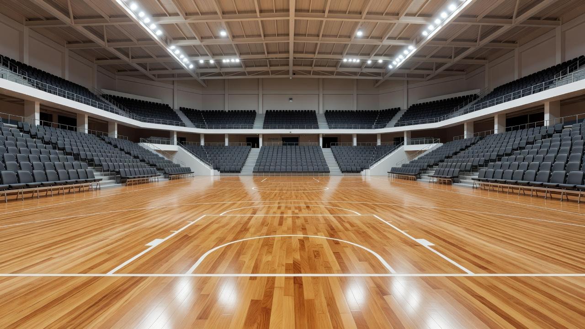

import ProblemBox from '../../../components/ProblemBox.astro';
import ConclusionBox from '../../../components/ConclusionBox.astro';
import BlogCard from '../../../components/BlogCard.astro';

<ProblemBox>
- 2028年開業予定の三河新アリーナはどこに建つ？（安城か豊橋か）
- 三河安城交流拠点の収容人数・開業時期・ホームチームは？
- ワークショップ「ミカワミライラボ」の役割と最新動向を知りたい
</ProblemBox>

<b>愛知県安城市の三河安城駅前に建設中の新アリーナ「三河安城交流拠点」は、2028年3月に竣工し、同年9月（秋）に開業予定です。</b>

建設予定地はJR「三河安城駅」から徒歩約3分のアイシン安城工場跡地で、約5,000席の観覧席を備えます。

あわせてB.LEAGUEの「シーホース三河」などが参画する地域共創プロジェクト「ミカワミライラボ」も動き出しました。

新幹線停車駅の目の前でプロバスケやバレー観戦を楽しみたい三河エリア住民なら、今から動線を押さえておきたい新拠点。

## 三河安城新アリーナの場所はどこ？安城市三河安城町1-11-2の地図と豊橋との違い

<b>正式な計画地は愛知県安城市三河安城町1丁目11番2ほかで、JR東海道新幹線・東海道本線「三河安城駅」から徒歩約3分の立地です。</b>

三河エリアでは豊橋公園内でも別の新アリーナ（2029年10月開業目標）が計画されています。安城市の計画と混同しないよう注意が必要。

安城市側が指すのは三河安城交流拠点で、2028年開業と「ミカワミライラボ」に対応します。新幹線で名古屋から約10分の好立地。

車移動が前提になりがちな郊外アリーナとは異なり、遠方からのアウェイ観戦客でも電車だけで完結できる点は大きな強み。

では、建物の規模やホームチーム、そして「ミカワミライラボ」とは具体的に何をしている取り組みなのでしょうか。

<iframe src="https://maps.google.co.jp/maps?q=%E6%84%9B%E7%9F%A5%E7%9C%8C%E5%AE%89%E5%9F%8E%E5%B8%82%E4%B8%89%E6%B2%B3%E5%AE%89%E5%9F%8E%E7%94%BA1-11-2&output=embed" width="100%" style="border:0; aspect-ratio: 16 / 10; height: auto; border-radius: 8px; margin: 1rem 0;" allowfullscreen loading="lazy" referrerpolicy="no-referrer-when-downgrade"></iframe>

## 三河安城交流拠点アリーナの規模・ホームチーム・ミカワミライラボとは？

<b>地上4階建て・延床面積約15,000㎡・観客席約5,000席のアリーナとなり、シーホース三河とクインシーズ刈谷が本拠地とします。</b>

ハード建設だけでなく、試合がない日も子どもが集える居場所づくりが進みます。B.LEAGUE×日本財団の助成事業「ミカワミライラボ」の始動。

| 計画項目 | 公表されている施設詳細 |
| :--- | :--- |
| **施設名称** | 三河安城交流拠点（アリーナ） |
| **竣工・開業予定** | 2028年3月竣工予定 ／ 2028年9月開業予定 |
| **所在地** | 愛知県安城市三河安城町1丁目11番2ほか |
| **規模・構造** | 敷地面積約30,000㎡ ／ 延床約15,000㎡ ／ 約5,000席 |
| **ホームチーム** | シーホース三河（B.LEAGUE）・クインシーズ刈谷（SV.LEAGUE） |

安城市内のアンフォーレ等で最終ワークショップを重ねています。スポーツとものづくりを掛け合わせた日常の賑わい設計。

単に試合観戦だけで終わらず、駅前に新しい市民の公園・広場的な空間が誕生する点に注目が集まっています。

### 三河安城新アリーナの飲食店テナントや駐車場台数は決まった？

<b>アリーナ内外に入る具体的な飲食店舗名や、一般来場者向け駐車場の最終運用台数・料金体系は現時点で公表されていません。</b>

ただしJR三河安城駅徒歩約3分という駅直結に近い立地条件から、開業後は公共交通機関での来場が最優先に推奨される見通し。

こけら落とし公演や開幕戦スケジュールなどの詳細は、2027年後半から2028年春の竣工前後に順次発表されます。

### 三河安城新アリーナを楽しむべき人・観戦時の注意点

<b>B.LEAGUEやSV.LEAGUEの試合を新幹線や在来線でスマートに観戦したいファンにとって、国内屈指のアクセス優秀アリーナになります。</b>

一方で2028年秋までは既存アリーナでの開催が続くため、現行の試合観戦と混同して駅周辺へ向かわないよう注意が必要です。

## 三河安城新アリーナのよくある質問（FAQ）

### Q. 三河安城新アリーナはいつオープンしますか？

2028年3月に建物が竣工し、2028年9月（秋）に開業・供用開始が予定されています。

### Q. 「ミカワミライラボ」とは何ですか？

2028年開業の新アリーナと連動し、シーホース三河や安城市などが進めるスポーツ×ものづくりの地域共創プロジェクトです。

## 三河安城新アリーナの開業計画まとめ

出典：[三河安城交流拠点アリーナ公式サイト](https://mikawa-arena.jp/) / [安城市公式ホームページ](https://www.city.anjo.aichi.jp/)

<ConclusionBox>
- <b>場所と混同注意：</b> 愛知県安城市三河安城町1-11-2（JR三河安城駅徒歩約3分）。豊橋の新アリーナ（2029年目標）とは別事業。
- <b>規模と時期：</b> 2028年3月竣工・9月開業予定。約5,000席を備え、シーホース三河・クインシーズ刈谷が本拠地化。
- <b>今後の注目：</b> 地域共創「ミカワミライラボ」でソフト面の実験が進行中。飲食や駐車場詳細は2027年以降の続報待ち。
</ConclusionBox>

愛知県内で2027年〜2028年に開業予定の複合施設は、名古屋・熱田区のMTG PARK記事でも確認できます。

<BlogCard slug="2026-11-25-open-fc99a7" />
