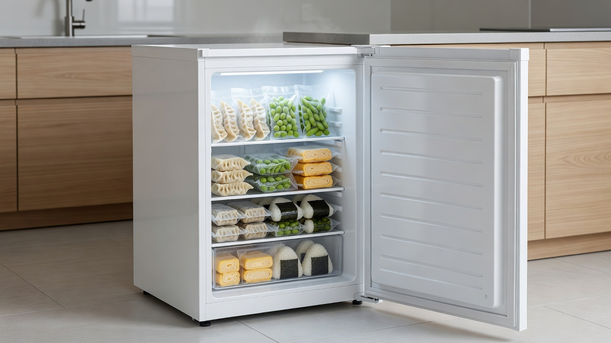

import ProblemBox from '../../../components/ProblemBox.astro';
import ConclusionBox from '../../../components/ConclusionBox.astro';
import BlogCard from '../../../components/BlogCard.astro';

<ProblemBox>
- 高島屋の冷凍庫＋冷食30日分福袋の価格と冷凍庫型番は？
- 2027年福袋の応募期間と、ネット応募ができるかを知りたい
- 対象となる高島屋11店舗はどこ？狙うべき条件を整理したい
</ProblemBox>

<b>高島屋の2027年新春福袋で、三菱電機製の家庭用冷凍庫と冷凍惣菜30日分がセットになった「冷凍食品のある暮らし」福袋が税込20,270円（配送料込み）で登場します。</b>

2027年にちなんだ特別価格に設定されており、限定5名の抽選販売です。

また120万円の京都・仁和寺デジタルデトックス体験など、実用特化と超非日常体験の二極化が際立つラインナップ。

応募は2027年1月3日・4日の店頭受付のみのため、ネット申込と勘違いしないよう事前確認が必須。

## 高島屋2027年福袋「冷凍庫＋冷食30日分」の型番と中身は？実質お得度を検証

<b>冷凍庫本体は三菱電機ホームフリーザー「MF-U12K」（容量121L・4段引き出し式）で、高島屋オリジナル冷凍惣菜「百味彩菜」30食分が付きます。</b>

121Lの独立型セカンド冷凍庫だけでも市販価格では数万円台が一般的なため、20,270円は価格設定として破格。

| 注目福袋名 | 税込価格・限定数 | 主な内容 |
| :--- | :--- | :--- |
| **冷凍食品のある暮らし** | 20,270円（限定5名） | 三菱電機冷凍庫MF-U12K（121L）＋百味彩菜11種30食 |
| **京都・仁和寺デジタルデトックス** | 1,200,000円（限定5組10名） | 仁和寺宿坊1泊2日・国宝特別案内・通信機器封印 |

惣菜30食分は黒酢酢豚や海老のチリソースなどの中華5種に加え、国産ハンバーグやグラタンの洋食6種という充実ぶり。

共働き世帯やまとめ買い派にとって、冷凍室のスペース不足と夕食準備の手間を一気に解消できる実用的な構成です。

## 高島屋2027年福袋の応募期間はいつ？対象11店舗と店頭限定の注意点

<b>応募受付期間は2027年1月3日（日）と1月4日（月）の2日間のみで、オンラインストアや電話での応募はできません。</b>

対象となる高島屋11店舗の店頭に足を運び、直接申し込む抽選方式が採用されています。

- <b>関東の受付店舗：</b> 日本橋店、新宿店、玉川店、横浜店、大宮店、柏店、高崎店
- <b>関西・中国の受付店舗：</b> 大阪店、泉北店、京都店、岡山店

限定5名という狭き門ですが、店頭申込限定だからこそオンライン抽選よりライバルが絞られる側面もあります。

### 高島屋2027年「冷凍庫福袋」に応募すべき人・見送るべき人

<b>自宅に幅約48cm前後のセカンド冷凍庫設置スペースを確保でき、正月3〜4日に店頭へ行ける方なら迷わず応募すべき企画。</b>

逆に搬入経路やコンセント位置を確認せずに当選すると設置に困るため、年内に置き場所の採寸を済ませておくのが安心です。

### 高島屋2027年「仁和寺デジタルデトックス福袋」はどんな内容？

<b>世界遺産・仁和寺の宿坊「松林庵」に宿泊し、通常非公開の国宝・重要文化財の僧侶案内や掃除修行を体験する1泊2日プランです。</b>

滞在中はスマホなどの通信機器を箱に封印するルールとなっており、日常のデジタル疲れから完全に離れたい富裕層向けの一品。

## 高島屋2027年福袋のよくある質問（FAQ）

### Q. 高島屋の冷凍庫付き福袋はオンラインで申し込めますか？

オンラインや電話での申し込みはできません。2027年1月3日・4日の2日間、対象11店舗の店頭でのみ抽選受付を行います。

### Q. 冷凍庫付き福袋の送料は別途かかりますか？

20,270円（税込）に配送料込みとなっています。詳細な設置・配送条件は応募時に店頭案内での確認が必要です。

## 高島屋2027年新春福袋の要点まとめ

出典：[株式会社髙島屋 公式情報](https://www.takashimaya.co.jp/)

<ConclusionBox>
- <b>破格の冷食福袋：</b> 三菱電機121L冷凍庫＋百味彩菜30食分で20,270円（税込・送料込・限定5名）。
- <b>応募の条件：</b> 2027年1月3日（日）・4日（月）の2日間、対象11店舗の店頭応募限定（ネット不可）。
- <b>事前準備：</b> 年内に冷凍庫の設置スペースを採寸し、年明け3〜4日の来店予定を押さえておくと確実。
</ConclusionBox>

物価高による家計防衛や個人消費の最新トレンドについては、内閣府の月例経済報告を整理した記事もあわせて確認できます。

<BlogCard slug="2026-11-25-trend-034ced" />
