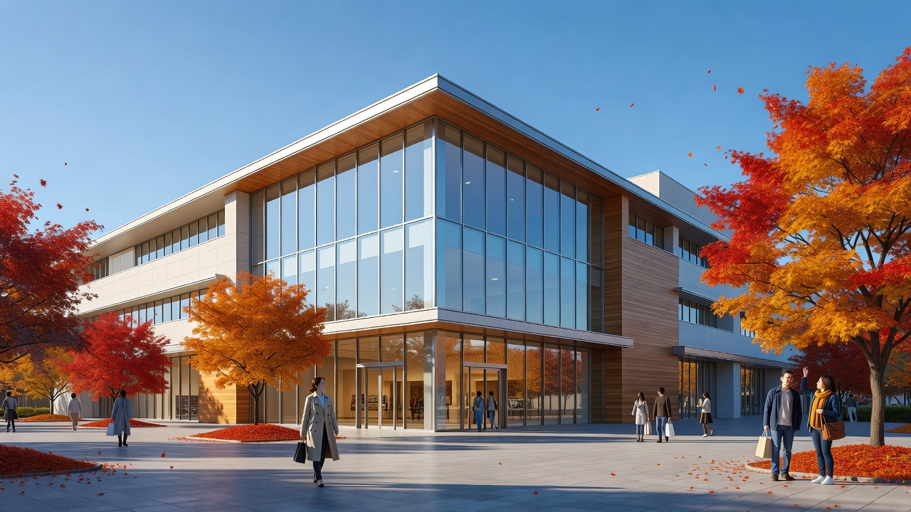

import ProblemBox from '../../../components/ProblemBox.astro';
import ConclusionBox from '../../../components/ConclusionBox.astro';

<ProblemBox>
- イオンモール伊達の場所と開業日は？
- ユニクロやGU、無印良品など、どんな店が入っている？
- 食品売場や専門店街は何時まで開いている？
</ProblemBox>

<b>イオンモール伊達は、2026年11月27日（金）午前9時に福島県伊達市でグランドオープンしました。</b>

総店舗数は約176店。核店舗は「イオンスタイル伊達」です。

福島県北では久しぶりの大型モールなので、週末は相当混みます。初日から地元メディアも「にぎわい」を報じています。

行くなら混雑のピークを外すのが正解です。

## イオンモール伊達の場所はどこ？伊達市堂ノ内の住所とアクセス

<b>所在地は福島県伊達市堂ノ内地区土地区画整理事業地内（〒960-0406）です。</b>

番地付きの住居表示ではなく、区画整理事業地内という表記になっています。カーナビは「イオンモール伊達」で施設検索するのが確実です。

<iframe src="https://maps.google.com/maps?q=%E3%82%A4%E3%82%AA%E3%83%B3%E3%83%A2%E3%83%BC%E3%83%AB%E4%BC%8A%E9%81%94&output=embed" width="100%" height="360" style="border:0;" loading="lazy" referrerpolicy="no-referrer-when-downgrade"></iframe>

駐車場の詳しい台数は、今回確認できた公式情報では把握できていません。現時点では公表内容を確認できていないため、オープン直後の土日は公共交通や時間帯の工夫も視野に入れたいところです。

## イオンモール伊達にユニクロ・GU・無印良品は入っている？主要テナント

<b>イオンスタイル伊達を核に、ユニクロ、ジーユー、無印良品、岩瀬書店、コジマ×ビックカメラ、SUPER SPORTS XEBIOなどが出店しています。</b>

服、本、家電、スポーツ用品まで一か所で揃うので、買い物の「行き先を迷う」ことがほぼなくなります。

専門店は173店舗＋外部棟3店舗の構成。ファミリー層なら、半日あっても足りないはずです。

## イオンモール伊達は何時まで？イオンスタイルと専門店街の営業時間

<b>営業時間は売場ごとに異なります。</b>

| 区分 | 営業時間 |
| :--- | :--- |
| イオンスタイル伊達 1階食品売場 | 9:00〜22:00 |
| イオンスタイル伊達 その他売場（2・3階など） | 9:00〜21:00 |
| 専門店街 | 10:00〜21:00 |
| レストラン街 | 11:00〜21:00 |

一部で営業時間が異なる店舗もあります。目当ての店がある方は、事前にイオンモール公式サイトで個別に確認してください。

仕事帰りに夕食の買い物をするなら、22時まで開く食品売場が一番使いやすいでしょう。

## イオンモール伊達は中心市街地とどう共存する？「30年越し開業」の見方

<b>報道によると、構想から30年以上を経ての開業で、中心市街地との共存が課題とされています。</b>

車で来る人にはありがたい施設です。一方、駅周辺の商店にとっては客足の行方が気になるはずです。

筆者は、モール開業直後の数か月が地元商店街の分かれ目になるとみています。モールの買い物とあわせて地元の店を回る動線が作れるかが鍵です。

<ConclusionBox>
- <b>開業日：</b> 2026年11月27日（金）9:00
- <b>場所：</b> 福島県伊達市堂ノ内地区土地区画整理事業地内
- <b>行くべき人：</b> 服・食品・家電を1日でまとめて買いたい県北エリアの家族連れ
- <b>注意：</b> 駐車場の詳細は現時点では確認できていません。初週末は混雑覚悟で
</ConclusionBox>

出典：イオンモール公式サイト、福島民友新聞社、中テレNEWS NNN
