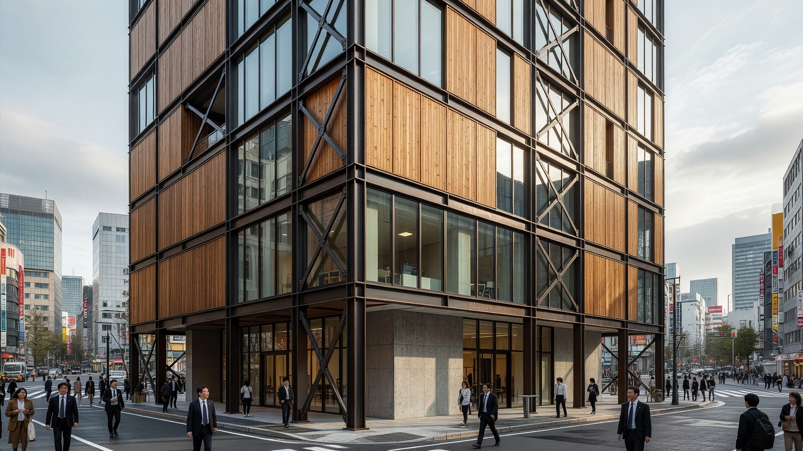

import ProblemBox from '../../../components/ProblemBox.astro';
import ConclusionBox from '../../../components/ConclusionBox.astro';

<ProblemBox>
- 渋谷マルイはどこに、どんな建物に建て替わる？
- いつ開業して、いつまで旧店舗は使える？
- テナントはもう決まっている？
</ProblemBox>

<b>「（仮称）渋谷マルイ建替計画」は、高層の商業施設として世界初となる木造・鉄骨のハイブリッド建築で、開業は2027年夏の予定です。</b>

設計のリードデザイナーはFoster+Partners。発注者は丸井、施工は戸田建設・住友林業JVが担います。

渋谷で「木の商業ビル」と聞くと意外ですが、構造の約6割に国産木材を使うという本気の計画です。

## 渋谷マルイ建替の場所はどこ？渋谷区神南1丁目の計画地

<b>所在地は東京都渋谷区神南1丁目22番6号ほかです。</b>

<iframe src="https://maps.google.com/maps?q=%E6%9D%B1%E4%BA%AC%E9%83%BD%E6%B8%8B%E8%B0%B7%E5%8C%BA%E7%A5%9E%E5%8D%971%E4%B8%81%E7%9B%AE22-6&output=embed" width="100%" height="360" style="border:0;" loading="lazy" referrerpolicy="no-referrer-when-downgrade"></iframe>

公園通り沿いの一等地です。若者の街の象徴的な立地に、環境配慮型の建物が建つ意味は小さくありません。

## 渋谷マルイは何階建て？高さ50m・延床約6,800㎡の規模

<b>建物は地下2階・地上9階建て、高さ約50m、延床面積約6,800㎡です。</b>

延床は大型百貨店と比べるとコンパクトです。つまり「何でも揃う」より「厳選された体験型」になる可能性が高いと私は見ています。

ただしテナント構成やフロア計画は、現時点では公表されていません。

## 渋谷マルイの開業はいつ？竣工は2027年9月末の予定

<b>竣工予定は2027年9月末、開業予定は2027年夏と案内されています。</b>

竣工より開業が先に見える点は、施設の一部先行開業などの可能性も考えられますが、公式の詳細は未確認です。続報を待ちましょう。

<ConclusionBox>
- <b>場所：</b> 東京都渋谷区神南1丁目22番6号ほか
- <b>規模：</b> 地下2階・地上9階、高さ約50m
- <b>注目：</b> 構造の約6割に国産木材を使う世界初の高層木造商業施設
- <b>行くべき人：</b> 建築・サステナブルなまちづくりに関心がある人。開業前は工事の進捗をチェック
</ConclusionBox>

出典：戸田建設、建通新聞、丸井グループ関連発表
