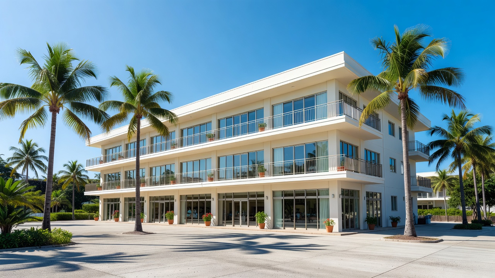

import ProblemBox from '../../../components/ProblemBox.astro';
import ConclusionBox from '../../../components/ConclusionBox.astro';

<ProblemBox>
- イオン一日橋店はどこにできて、いつ開業する？
- バーミヤンやジェリコ堂はいつから行ける？
- 駐車場や営業時間はもう発表されている？
</ProblemBox>

<b>イオン一日橋店は、2026年12月10日に沖縄県南風原町でオープンします。</b>

マックスバリュ一日橋店の跡地を建て替えた、地上3階建ての商業施設です。約30の専門店が入ります。

注目は、すかいらーく系の「バーミヤン」と、コメダグループの「ジェリコ堂」の沖縄初出店。南部エリアの外食が一気に賑やかになります。

## イオン一日橋店の場所はどこ？南風原町字兼城530番地の住所

<b>住所は沖縄県島尻郡南風原町字兼城530番地で、国道329号の一日橋交差点近く、イオン琉球本社に隣接します。</b>

<iframe src="https://maps.google.com/maps?q=%E6%B2%96%E7%B8%84%E7%9C%8C%E5%B3%B6%E5%B0%BB%E9%83%A1%E5%8D%97%E9%A2%A8%E5%8E%9F%E7%94%BA%E5%AD%97%E5%85%BC%E5%9F%8E530&output=embed" width="100%" height="360" style="border:0;" loading="lazy" referrerpolicy="no-referrer-when-downgrade"></iframe>

那覇方面から車で寄りやすい立地です。慣れた道沿いに新しい選択肢が増えるのは、地元の方にはかなり大きな変化でしょう。

営業時間と駐車場台数は、現時点では公表内容を確認できていません。例年のイオン系施設は食品売場が夜まで営業する傾向があるため、続報を待つのが安全です。

## ジェリコ堂は沖縄初出店？バーミヤンとあわせて注目の店

<b>コメダグループの「ジェリコ堂」は、名物デザートドリンク「ジェリコ」で知られる新業態で、沖縄初出店となります。</b>

バーミヤンは「バーミヤン イオン一日橋店」として出店。買い物のついでに家族で中華、というパターンが定着しそうです。

甘いもの目当てならジェリコ堂、家族の食事ならバーミヤン。使い分けるのがおすすめです。

## イオン琉球本社機能も入る？マックスバリュ跡地の建て替えポイント

<b>報道では、イオン琉球の本社機能も併設されると伝えられています。</b>

単なるショッピングセンターではなく、地域の拠点として整備される位置づけです。

ただし本社機能の具体的な入居フロアなどは、現時点では公表されていません。

<ConclusionBox>
- <b>開業日：</b> 2026年12月10日
- <b>場所：</b> 沖縄県島尻郡南風原町字兼城530番地
- <b>行くべき人：</b> 沖縄南部で外食と日用品をまとめて済ませたい人
- <b>未発表：</b> 営業時間・駐車場台数・全テナント一覧
</ConclusionBox>

出典：琉球新報デジタル、イオン琉球関連報道
